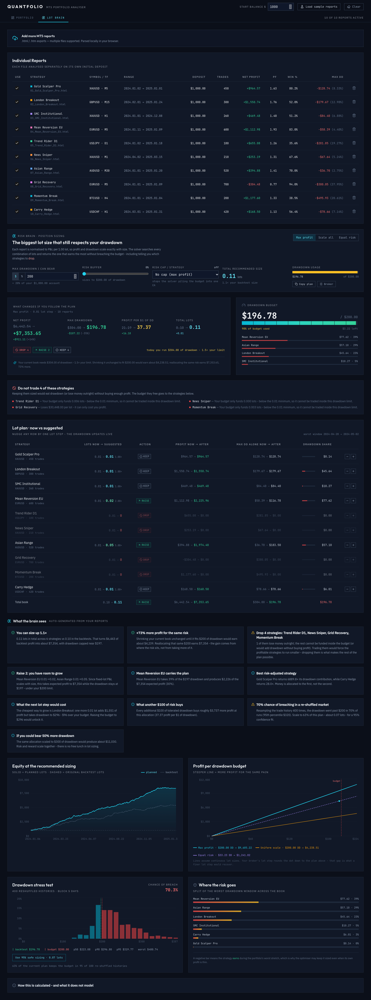

# QuantFolio — MT5 Strategy Analyser

Upload any number of **MT5 Strategy Tester reports** and analyse them as one book: a true combined
drawdown, an equity curve built deal-by-deal, and a **position-sizing optimiser** that tells you the
maximum lot size for every strategy — and which strategies to stop trading — while keeping your
drawdown under a limit you choose.

Everything runs **in the browser**. Reports are parsed locally; nothing is uploaded anywhere.



<sub>Lot Brain with a $200 drawdown budget over a ten-strategy book (synthetic demo data).</sub>

---

## Why this exists

Combining backtests is easy; knowing **how big to trade them** is not. Every MT5 report is produced at
one fixed lot size, and fixed-lot P&L is linear in lot size — double the lot and every win, loss,
commission and dollar of drawdown doubles with it.

That single property is enough to answer the sizing question **exactly**:

> *"I can bear $200 of drawdown. What is the largest lot size for each of my 10 EAs such that the
> combined book never draws down more than $200?"*

## Two views

### Portfolio
- Per-report table: trades, net profit, profit factor, win rate, own max DD (include/exclude any report)
- Combined KPIs with the real peak/trough timestamps
- Combined balance curve + underwater chart, worst-drawdown window with every deal
- FTMO-style profit calendar (days/weeks, $ or % of balance), monthly matrix and worst-day rankings
- Click any calendar day for the **full trade list**: open/close time and price, time held, EA, side,
  lots, P&L per trade, SL/TP tags, a by-EA filter and the day's best/worst trade. Deals are paired
  back into trades (FIFO per symbol, partial closes split, commissions allocated pro rata) so the
  list reconciles exactly with the calendar cell

### Lot Brain — position sizing optimiser
- **Drawdown budget** in $ or % of the account, optional risk buffer, per-strategy risk cap
  (default: no single EA may draw down more than the whole budget on its own), broker lot step /
  minimum lot, max lots per strategy
- **Per-strategy verdict: `RAISE` / `CUT` / `KEEP` / `DROP`**, each with a numeric reason, e.g.
  *"One 0.01 lot takes drawdown to $207.02 — $7.02 over your limit (it would add $381.23 of profit)"*
- **Before vs after**: net profit, max drawdown, profit per $1 of drawdown and total lots — now vs
  optimised — including the "shrink the same book until it fits" baseline the reallocation has to beat
- Nothing below the broker minimum lot is ever suggested: a strategy that cannot be funded at
  0.01 lots is marked **DROP**, never resized below the minimum
- **Month-by-month P&L**, current lots vs recommended lots, as grouped bars and a table with the
  change and % change per month (totals reconcile with the headline before/after)
- **Risk attribution** of the worst window (additive; negative = a strategy that hedges the book)
- **Efficient frontier** comparing max-profit, uniform-scale and equal-risk sizing at the same budget
- **Monte Carlo** block bootstrap over the joint daily P&L (400 reshuffled histories, all strategies
  resampled on the same days so correlation is preserved): p50/p90/p95/worst, probability of
  breaching the budget, and a one-click "95% safe sizing"
- Copy the whole plan to the clipboard, ready to configure in MT5

## How the optimiser works

1. **Normalise** — every deal is divided by its own lot, so each report becomes P&L per `1.00` lot.
2. **Merge** — all normalised deals are replayed on one timeline, to the second.
3. **Solve** — for a lot vector `w`, equity is `start + Σ wᵢ·Cᵢ(t)`, so drawdown is
   `max_{s≤t} Σ wᵢ·(Cᵢ(s) − Cᵢ(t))` — a **max of linear functions**, i.e. convex and positively
   homogeneous. *Maximise profit subject to DD ≤ budget* is therefore a linear program. A
   cutting-plane loop solves the LP over the windows found so far, measures the true drawdown of that
   answer, adds the violated window as a new constraint and repeats until the LP solution is feasible
   — at which point it is **provably optimal** for that budget.
4. **Respect the broker** — the continuous optimum is floored to the lot step, then a greedy step
   refinement spends the leftover budget one lot step at a time (checked with an exact O(T) drawdown walk).
5. **Stress** — the plan is re-run through the block bootstrap to see how often the budget would have
   been breached on a different ordering of the same history.

Because drawdown is homogeneous, the optimal allocation is a single direction in lot space: your
budget only scales the size. That is also why the efficient frontier is a set of straight lines and
why "equal risk" or "scale everything by the same multiplier" are just different slopes.

## Quick start

```bash
cd frontend
yarn install
yarn start          # http://localhost:3000
```

Load the two bundled sample reports with **Load sample reports**, or drop your own `.html` / `.htm`
exports from `View → Strategy Tester → Report → Save as HTML`.

Then open the **Lot brain** tab, type the maximum drawdown you can bear, and read the plan.

### Tests

```bash
cd frontend
CI=true yarn test --watchAll=false
```

29 tests cover the optimiser (LP result vs a random-search optimum, drawdown homogeneity, budget
compliance, minimum-lot handling, verdicts, Monte Carlo determinism) and an end-to-end parse of the
bundled MT5 reports.

## Project structure

```
frontend/src
├── lib
│   ├── mt5Parser.js    # UTF-16/UTF-8 decode, DOMParser, Deals table → trades
│   ├── portfolio.js    # merge all reports, stats, drawdown walk, months, days
│   ├── calendar.js     # Monday-first month grid, week rollups
│   ├── simplex.js      # dense primal simplex solver
│   ├── riskBrain.js    # normalisation, drawdown evaluation, optimisers, Monte Carlo
│   └── insights.js     # plain-English analysis of the optimiser output
├── components
│   ├── RiskBrain.jsx   # the Lot Brain tab (controls, plan, verdicts, insights)
│   ├── BrainCharts.jsx # equity, frontier and Monte Carlo charts
│   └── …               # portfolio tables, charts, uploader
└── App.js              # tab shell: Portfolio | Lot Brain
```

`backend/` is an optional FastAPI stub from the original scaffold; the app is frontend-only.

## Limitations

The linear-scaling assumption holds for **fixed-lot** strategies. It does **not** hold for
compounding, martingale or equity-based sizing. Spread widening, slippage, swap, margin calls and
each broker's maximum lot per order are not modelled.

The drawdown shown is the worst peak-to-trough dip *in the backtested period*. The Monte Carlo gives
a distribution around it. Neither guarantees the future — size so that a bad streak is survivable.
